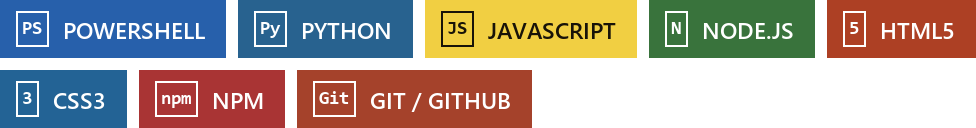

**Системное администрирование, сети и автоматизация.**  
Веб-проекты, инструменты для Discord и локализация.

## Системы и хранилища

## Сети и мониторинг

## Разработка и автоматизация

## Базы данных и форматы

## API и интеграции

## Локализация

## Избранные проекты

- **[Discord Status](https://github.com/Alexan1111t/Ukraine-Mod-Community-Discord-Status)** — число игроков на серверах прямо в профиле Discord.
- **FileX** — [украинская](https://github.com/Alexan1111t/filex-lang-uk) и [русская](https://github.com/Alexan1111t/filex-lang-ru) локализации.
- **[iHorizon](https://github.com/Alexan1111t/ihrz.github.io)** — многоязычный сайт Discord-бота.

[Все репозитории →](https://github.com/Alexan1111t?tab=repositories)
